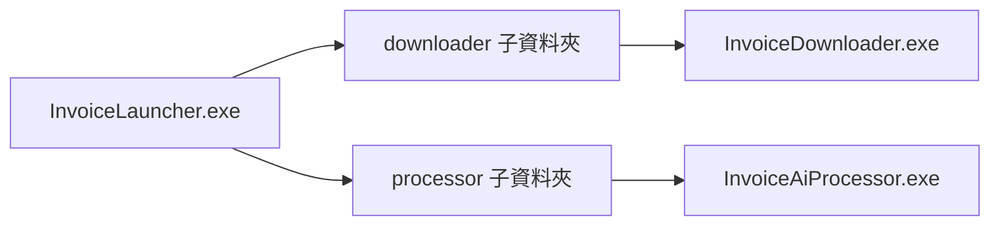

# 發票智慧助理

以在地部署為優先的 Windows 桌面解決方案，用於發票下載與 AI 輔助會計分析。

## 產品概述

發票智慧助理協助會計團隊在本地基礎設施內，自動化處理大量發票作業流程。

核心成果：

- 匯入客戶清單與日期區間。
- 以批次模式下載發票。
- 套用分層式 AI 決策流程。
- 匯出強化後的 Excel 結果供後續會計作業使用。
- 將核准的人工回饋寫入知識庫。

## 架構

系統由兩個可獨立執行的模組組成。

### 模組 A：發票下載器

- 匯入客戶清單 Excel。
- 讀取統編、公司名稱與日期區間。
- 與 MOF 服務進行驗證。
- 批次下載發票檔案。
- 將原始檔案匯出到 Folder A。

### 模組 B：發票 AI 處理器

- 從 Folder A 讀取原始檔案。
- 優先執行規則引擎。
- 透過案例快取重用歷史判定。
- 執行 RAG 檢索取得脈絡案例。
- 對未解決紀錄使用本地 LLM 推理。
- 將強化檔案匯出到 Folder B。

決策流程：

客戶清單 -> 發票下載器 -> Folder A -> 規則引擎 -> 案例快取 -> RAG -> LLM -> Folder B -> 人工知識回饋

## 技術堆疊

桌面端：

- C#
- .NET 8
- WPF

AI 與檢索：

- Ollama
- Qwen3 8B
- BGE-M3
- Qdrant

設定與資料：

- INI 設定檔
- 以 Excel 為主的輸入與輸出
- 本地檔案系統資料夾

## 產品範圍

包含：

- 客戶清單匯入
- 發票下載
- 本地 AI 分析
- 強化版 Excel 匯出
- 命名規則設定
- 人工知識回饋

不包含：

- ERP 整合
- 行動應用程式
- 公有雲部署
- 未經核准的自動學習
- 多租戶 SaaS

## 非功能性目標

- 支援 Windows 10 與 Windows 11
- 啟動時間低於 5 秒
- 每批支援 150 家客戶公司
- 每次執行可處理 15,000 至 30,000 筆發票
- 檔案產生成功率高於 99%
- 不呼叫外部 AI 推理服務

## 在地化政策

- 開發與技術文件：英文
- 使用者介面、輸出內容與訊息：繁體中文

## 儲存庫文件

- 產品需求索引：docs/prd/00-index.md
- 主 PRD：docs/prd/01-master-prd.md
- 專案定義與路線圖：docs/project.md
- 分支執行流程：docs/status.md
- 測試目錄與測項清單：docs/testing.md
- 程式風格基線與語言附錄：docs/style/

## 目前可執行骨架

- 解決方案檔：InvoiceIntelligenceAssistant.slnx
- 應用程式：src/InvoiceLauncher、src/InvoiceDownloader、src/InvoiceAiProcessor
- 共用核心：src/InvoiceIntelligence.Core
- 設定檔範本：config/downloader.ini、config/processor.ini
- 主控台（InvoiceLauncher）提供統一設定視窗：可集中編輯根目錄 config 下的 downloader.ini 與 processor.ini。
- 子模組（Downloader / Processor）獨立執行時不提供設定 UI。
- Downloader 已支援客戶清單 Excel 匯入、MOF 驗證，以及批次下載原始發票 Excel 至 Folder A 並輸出下載記錄。
- AI Processor 已支援 Folder A 原始發票讀取、分階段 AI 決策流程（Rule Engine -> Case Cache -> RAG -> LLM），並可將保留原始欄位且附加 AI 欄位的強化 Excel 匯出至 Folder B。
- AI Processor 已支援手動知識回饋：可勾選人工核准紀錄並更新本地知識庫，且後續執行會將已核准案例載入 RAG 檢索。
- 目前版本已完成在地化與品質閘道：使用者可見訊息與輸出欄位維持繁體中文，且已加入離線 AI 驗證與目標規模效能測試。

## 模組化部署指南（可只交付單一模組）

### 一鍵打包腳本

```powershell
.\scripts\publish-downloader.ps1
.\scripts\publish-processor.ps1
.\scripts\publish-all.ps1
```

可選參數：

```powershell
.\scripts\publish-downloader.ps1 -Runtime win-x64 -Configuration Release
.\scripts\publish-processor.ps1 -Runtime win-x64 -Configuration Release
.\scripts\publish-all.ps1 -Runtime win-x64 -Configuration Release
```

若遇到「因為這個系統上已停用指令碼執行，所以無法載入 .ps1 檔案」錯誤，請先在同一個 PowerShell 視窗執行：
例如:
.\scripts\publish-all.ps1 : 無法辨識 '.\scripts\publish-all.ps1' 詞彙是否為 Cmdlet、函數、指令檔或可執行程式的名稱。請檢查名稱拼字是否正確，如果包含路徑的話，請確認路徑是否正確，然後再試一次。

```powershell
Set-ExecutionPolicy -Scope Process -ExecutionPolicy Bypass -Force
.\scripts\publish-all.ps1 -Runtime win-x64 -Configuration Release
```

參數說明：

- `-Runtime`
  指定目標 Windows Runtime Identifier（RID）。
- `win-x64`：64 位元 Windows（建議正式交付使用）。
- `win-x86`：32 位元 Windows。
- `win-arm64`：ARM64 Windows。
- `-Configuration`
  指定建置組態。
- `Release`：正式版，最佳化輸出，建議交付客戶。
- `Debug`：除錯版，供內部測試與開發調查。

其他常用參數（選用）：

- `-FrameworkDependent`
  改為 framework-dependent 打包，不內含 .NET Runtime（客戶端需先安裝對應 Runtime）。
- `-OutputPath`（publish-downloader / publish-processor）
	指定輸出根路徑（預設皆為 `build/deploy/InvoiceIntelligence`）。
- `-DeployRoot`（publish-all）
	指定輸出根路徑（預設為 `build/deploy`，實際整包輸出到 `build/deploy/InvoiceIntelligence`）。
- `-SkipZip`（publish-all）
  僅產出資料夾，不建立 zip 檔。

- `publish-all` 預設輸出（推薦交付客戶）：`build/deploy/InvoiceIntelligence`
- `publish-downloader` 預設輸出：`build/deploy/InvoiceIntelligence`
- `publish-processor` 預設輸出：`build/deploy/InvoiceIntelligence`
- 預設為 self-contained 打包（客戶端可不先安裝 .NET Runtime）。
- 如需 framework-dependent 打包，可加上 `-FrameworkDependent`。
- 若遇到 PowerShell 執行政策封鎖，可先執行：`Set-ExecutionPolicy -Scope Process -ExecutionPolicy Bypass -Force`（僅作用於當前視窗）。

### 部署資料夾結構

整合部署（Downloader + Processor + 主控台）：

```text
InvoiceIntelligence/
|-- InvoiceLauncher.exe
|-- downloader/
|-- processor/
`-- config/
    |-- downloader.ini
    `-- processor.ini
```

只部署 Downloader：

```text
InvoiceIntelligence/
|-- downloader/
`-- config/
    `-- downloader.ini
```

只部署 Processor：

```text
InvoiceIntelligence/
|-- processor/
`-- config/
    `-- processor.ini
```

### 部署流程 0：主控台整合部署（推薦）

步驟：

1. 執行 `scripts/publish-all.ps1`。
2. 交付 `build/deploy/InvoiceIntelligence` 整個資料夾給客戶端。
3. 客戶端直接執行 `build/deploy/InvoiceIntelligence/InvoiceLauncher.exe`。
4. 在主控台使用「設定」集中管理 `config/downloader.ini` 與 `config/processor.ini`。
5. 如需執行完整流程，在主控台按「執行完整流程」（先啟動 Downloader，關閉後可接續啟動 Processor）。
6. 如需獨立執行單一模組，請進入對應子資料夾：
	`build/deploy/InvoiceIntelligence/downloader/InvoiceDownloader.exe` 或 `build/deploy/InvoiceIntelligence/processor/InvoiceAiProcessor.exe`。
7. 子模組獨立執行時不提供設定 UI。

流程：



### 部署流程 A：只部署 Downloader（模組 A）

步驟：

1. 執行 `scripts/publish-downloader.ps1`。
2. 交付 `build/deploy/InvoiceIntelligence` 整個資料夾給客戶端（包含 `downloader` 與 `config`）。
3. 確認 `config/downloader.ini` 參數（folderA、folderB、mof.account、mof.appId、mof.appKey）。
4. 若採官方 API，設定 `mof.invoiceDownloadMode=official` 與 `mof.officialApiBaseUrl`。
5. 客戶端執行 `downloader/InvoiceDownloader.exe`。
6. 驗證是否成功輸出檔案到 Folder A，並產生下載紀錄 `.log`。
7. 此模式不提供設定 UI，請直接編輯 `config/downloader.ini`。

流程：


### 部署流程 B：只部署 AI Processor（模組 B）

步驟：

1. 執行 `scripts/publish-processor.ps1`。
2. 交付 `build/deploy/InvoiceIntelligence` 整個資料夾給客戶端（包含 `processor` 與 `config`）。
3. 確認 `config/processor.ini` 參數（folderA、folderB、output.fileNamingRule、knowledge.repositoryFile）。
4. 將待分析原始檔放入 Folder A。
5. 客戶端執行 `processor/InvoiceAiProcessor.exe`。
6. 驗證 Folder B 是否產生強化 Excel，並可選擇執行人工回饋更新知識庫。
7. 此模式不提供設定 UI，請直接編輯 `config/processor.ini`。

流程：


### 模組相依與格式注意事項

- Processor 目前只會讀取 Folder A 下的 `.xlsx` 檔案。
- Downloader 在 local 模式輸出 `.xlsx`；official 模式輸出 `.csv`。
- 若要將 Downloader 輸出直接餵給 Processor，請確保 Folder A 內容符合 Processor 期望的 `.xlsx` 欄位格式。

### 本機驗證指令

```powershell
dotnet build InvoiceIntelligenceAssistant.slnx -v minimal
dotnet test InvoiceIntelligenceAssistant.slnx -v minimal
dotnet format InvoiceIntelligenceAssistant.slnx --verify-no-changes
```

兩個桌面模組會在啟動時讀取對應 INI 設定並驗證命名規則占位符；官方 API 憑證欄位採 appId/appKey。
