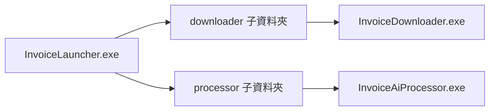

# 發票智慧助理

以在地部署為優先的 Windows 桌面解決方案，用於發票下載與 AI 輔助會計分析。

## 產品概述

發票智慧助理協助會計團隊在本地基礎設施內，自動化處理大量發票作業流程。

核心成果：

- 匯入客戶清單與日期區間。
- 以批次模式下載發票。
- 套用分層式 AI 決策流程。
- 匯出強化後的 Excel 結果供後續會計作業使用。
- 將核准的人工回饋寫入知識庫。

## 架構

系統由兩個可獨立執行的模組組成。

### 模組 A：發票下載器

- 匯入客戶清單 Excel。
- 讀取統編、公司名稱與日期區間。
- 與 MOF 服務進行驗證。
- 批次下載發票檔案。
- 將原始檔案匯出到原始發票資料夾（Folder A）。

### 模組 B：發票 AI 處理器

- 從原始發票資料夾（Folder A）讀取原始檔案。
- 優先執行規則引擎。
- 透過案例快取重用歷史判定。
- 執行 RAG 檢索取得脈絡案例。
- 對未解決紀錄使用本地 LLM 推理。
- 將強化檔案匯出到 AI 分析結果資料夾（Folder B）。

決策流程：

客戶清單 -> 發票下載器 -> 原始發票資料夾 -> 規則引擎 -> 案例快取 -> RAG -> LLM -> AI 分析結果資料夾 -> 人工知識回饋

## 技術堆疊

桌面端：

- C#
- .NET 8
- WPF

AI 與檢索：

- Ollama
- Qwen3 8B
- BGE-M3
- Qdrant

設定與資料：

- INI 設定檔
- 以 Excel 為主的輸入與輸出
- 本地檔案系統資料夾

## 產品範圍

包含：

- 客戶清單匯入
- 發票下載
- 本地 AI 分析
- 強化版 Excel 匯出
- 命名規則設定
- 人工知識回饋

不包含：

- ERP 整合
- 行動應用程式
- 公有雲部署
- 未經核准的自動學習
- 多租戶 SaaS

## 非功能性目標

- 支援 Windows 10 與 Windows 11
- 啟動時間低於 5 秒
- 每批支援 150 家客戶公司
- 每次執行可處理 15,000 至 30,000 筆發票
- 檔案產生成功率高於 99%
- 不呼叫外部 AI 推理服務

## 在地化政策

- 開發與技術文件：英文
- 使用者介面、輸出內容與訊息：繁體中文

## 儲存庫文件

- 產品需求索引：docs/prd/00-index.md
- 主 PRD：docs/prd/01-master-prd.md
- 專案定義與路線圖：docs/project.md
- 分支執行流程：docs/status.md
- 測試目錄與測項清單：docs/testing.md
- 程式風格基線與語言附錄：docs/style/

## 目前可執行骨架

- 解決方案檔：InvoiceIntelligenceAssistant.slnx
- 應用程式：src/InvoiceLauncher、src/InvoiceDownloader、src/InvoiceAiProcessor
- 共用核心：src/InvoiceIntelligence.Core
- 設定檔範本：config/downloader.ini、config/processor.ini
- 主控台（InvoiceLauncher）提供統一設定視窗：可集中編輯根目錄 config 下的 downloader.ini 與 processor.ini。
- 主控台設定視窗可調整輸出分流關鍵欄位：invoiceFileSuffix、allowanceFileSuffix、invoiceOutputLabel、allowanceOutputLabel。
- 子模組（Downloader / Processor）獨立執行時不提供設定 UI。
- Downloader 已支援客戶清單 Excel 匯入、MOF 驗證，以及批次下載原始發票 Excel 至原始發票資料夾（Folder A）並輸出下載記錄。
- AI Processor 已支援原始發票資料夾（Folder A）原始發票讀取、分階段 AI 決策流程（Rule Engine -> Case Cache -> RAG -> LLM），並可將保留原始欄位且附加 AI 欄位的強化 Excel 匯出至 AI 分析結果資料夾（Folder B）。
- AI Processor 已支援低信心人工覆核流程：可設定信心門檻，低於門檻的公司來源群組（同檔名基底，`-invoice` / `-allowance` 視為同組）會匯出至人工覆核資料夾（Folder C），待人工覆核後可再複製回 AI 分析結果資料夾（Folder B）。
- AI Processor 已支援手動知識回饋：可勾選人工核准紀錄並更新本地知識庫，且後續執行會將已核准案例載入 RAG 檢索。
- AI Processor 目前使用本地向量相似度檢索（Vector RAG baseline）進行參考案例排序，維持離線執行且不依賴外部 AI API。
- AI Processor 已支援免 CLI 訓練流程 UI：可在應用程式內完成資料集驗證、訓練、評估與核准發布模型。
- 目前版本已完成在地化與品質閘道：使用者可見訊息與輸出欄位維持繁體中文，且已加入離線 AI 驗證與目標規模效能測試。

## 開發與交付快速路徑

### PowerShell 前置（僅當前視窗）

若遇到 `.ps1` 無法執行，先在同一個 PowerShell 視窗執行：

```powershell
Set-ExecutionPolicy -Scope Process -ExecutionPolicy Bypass -Force
```

### 1) 開發環境自檢（Git Clone 後第一步）

使用下列腳本檢查機器是否具備可建置條件（.NET SDK + restore/build）：

```powershell
.\scripts\check-developer-environment.ps1
```

常用參數：

- `-Configuration Release|Debug`

### 2) 本機驗證（開發者）

```powershell
dotnet build InvoiceIntelligenceAssistant.slnx -v minimal
dotnet test InvoiceIntelligenceAssistant.slnx -v minimal
dotnet format InvoiceIntelligenceAssistant.slnx --verify-no-changes
```

## 模組化部署指南（可只交付單一模組）

### 3) 一鍵打包腳本

```powershell
.\scripts\publish-downloader.ps1
.\scripts\publish-processor.ps1
.\scripts\publish-all.ps1
```

常見用法：

```powershell
.\scripts\publish-downloader.ps1 -Runtime win-x64 -Configuration Release
.\scripts\publish-processor.ps1 -Runtime win-x64 -Configuration Release
.\scripts\publish-all.ps1 -Runtime win-x64 -Configuration Release
```

常用參數：

- `-Runtime win-x64|win-x86|win-arm64`：目標 Windows RID。
- `-Configuration Release|Debug`：建置組態。
- `-FrameworkDependent`：改為 framework-dependent 打包（客戶端需安裝對應 .NET Runtime）。
- `-OutputPath`（publish-downloader / publish-processor）：指定輸出根路徑（預設 `build/deploy/InvoiceIntelligence`）。
- `-DeployRoot`（publish-all）：指定輸出根路徑（預設 `build/deploy`，整包在 `build/deploy/InvoiceIntelligence`）。
- `-SkipZip`（publish-all）：僅產出資料夾，不建立 zip。

輸出與預設：

- 三個 publish 腳本預設輸出皆在 `build/deploy/InvoiceIntelligence`。
- 預設為 self-contained 打包；若客戶端已具備 Runtime 可使用 `-FrameworkDependent`。

### 4) 客戶端環境檢查（check-customer-environment.ps1）

`check-customer-environment.ps1` 用於驗證部署包是否可在客戶端環境執行。

檢查內容：

- 作業系統是否為 Windows。
- 部署資料夾與必要檔案是否存在（exe、dll、deps、runtimeconfig、config）。
- 每個模組根目錄是否存在 `libs/`，且根目錄不殘留 `.dll`。
- 若為 framework-dependent 打包，會檢查 `dotnet` 與所需 shared runtime 是否已安裝。

參數：

- `-PackageRoot <path>`：指定部署根目錄（例如 `build/deploy/InvoiceIntelligence`）。
- `-Profile all|downloader|processor`：指定檢查範圍，預設為 `all`。

範例：

```powershell
# 在 repo 根目錄執行（檢查整合包）
.\scripts\check-customer-environment.ps1 -PackageRoot .\build\deploy\InvoiceIntelligence -Profile all

# 在交付給客戶的部署資料夾根目錄執行
.\check-customer-environment.ps1 -Profile all
```

回傳碼：

- `0`：Environment status = READY
- `1`：Environment status = NOT READY

### 部署資料夾結構

整合部署（Downloader + Processor + 主控台）：

```text
InvoiceIntelligence/
|-- InvoiceLauncher.exe
|-- libs/
|-- downloader/
|   `-- libs/
|-- processor/
|   `-- libs/
`-- config/
    |-- downloader.ini
    `-- processor.ini
```

只部署 Downloader：

```text
InvoiceIntelligence/
|-- downloader/
|   `-- libs/
`-- config/
    `-- downloader.ini
```

只部署 Processor：

```text
InvoiceIntelligence/
|-- processor/
|   `-- libs/
`-- config/
    `-- processor.ini
```

- 每個可執行模組（主控台、Downloader、Processor）根目錄保留啟動用 `*.exe` 包裝器；實際執行檔與所有 `.dll` 皆位於 `libs/`。

### 部署流程 0：主控台整合部署（推薦）

步驟：

1. 執行 `scripts/publish-all.ps1`。
2. 交付 `build/deploy/InvoiceIntelligence` 整個資料夾給客戶端。
3. 客戶端直接執行 `build/deploy/InvoiceIntelligence/InvoiceLauncher.exe`。
4. 在主控台使用「設定」集中管理 `config/downloader.ini` 與 `config/processor.ini`。
5. 如需執行完整流程，在主控台按「執行完整流程」（先啟動 Downloader，關閉後可接續啟動 Processor）。
6. 如需獨立執行單一模組，請進入對應子資料夾：
	`build/deploy/InvoiceIntelligence/downloader/InvoiceDownloader.exe` 或 `build/deploy/InvoiceIntelligence/processor/InvoiceAiProcessor.exe`。
7. 子模組獨立執行時不提供設定 UI。

流程：



### 部署流程 A：只部署 Downloader（模組 A）

步驟：

1. 執行 `scripts/publish-downloader.ps1`。
2. 交付 `build/deploy/InvoiceIntelligence` 整個資料夾給客戶端（包含 `downloader` 與 `config`）。
3. 確認 `config/downloader.ini` 參數（folderA=原始發票資料夾、folderB=AI 分析結果資料夾、mof.account、mof.appId、mof.appKey、mof.passwordEncrypted）。
4. 設定 `mof.officialApiBaseUrl`（下載模式固定為 `official`）。
5. 客戶端執行 `downloader/InvoiceDownloader.exe`。
6. 驗證是否成功輸出檔案到原始發票資料夾（Folder A），並產生下載紀錄 `.log`。
	- official 模式：每個客戶同時產生 2 個 `.xlsx`（`-invoice` 與 `-allowance`）。
7. 此模式不提供設定 UI，請直接編輯 `config/downloader.ini`。

流程：


### 部署流程 B：只部署 AI Processor（模組 B）

步驟：

1. 執行 `scripts/publish-processor.ps1`。
2. 交付 `build/deploy/InvoiceIntelligence` 整個資料夾給客戶端（包含 `processor` 與 `config`）。
3. 確認 `config/processor.ini` 參數（folderA=原始發票資料夾、folderB=AI 分析結果資料夾、output.fileNamingRule、knowledge.repositoryFile）。
4. 將待分析原始檔放入原始發票資料夾（Folder A）。
5. 客戶端執行 `processor/InvoiceAiProcessor.exe`。
6. 驗證 AI 分析結果資料夾（Folder B）是否產生強化 Excel，並可選擇執行人工回饋更新知識庫。
7. 此模式不提供設定 UI，請直接編輯 `config/processor.ini`。

流程：


### 模組相依與格式注意事項

- Processor 目前只會讀取原始發票資料夾（Folder A）下的 `.xlsx` 檔案。
- Downloader 固定使用 official 模式，並輸出 `.xlsx`。
- Downloader 會分別輸出進銷項與折讓兩個檔案（檔名尾碼為 `-invoice`、`-allowance`）。
- 若要將 Downloader 輸出直接餵給 Processor，請確保原始發票資料夾（Folder A）內容符合 Processor 期望的 `.xlsx` 欄位格式。

兩個桌面模組會在啟動時讀取對應 INI 設定並驗證命名規則占位符；MOF 官方 API 憑證（appId/appKey/password）僅適用於 Downloader。
