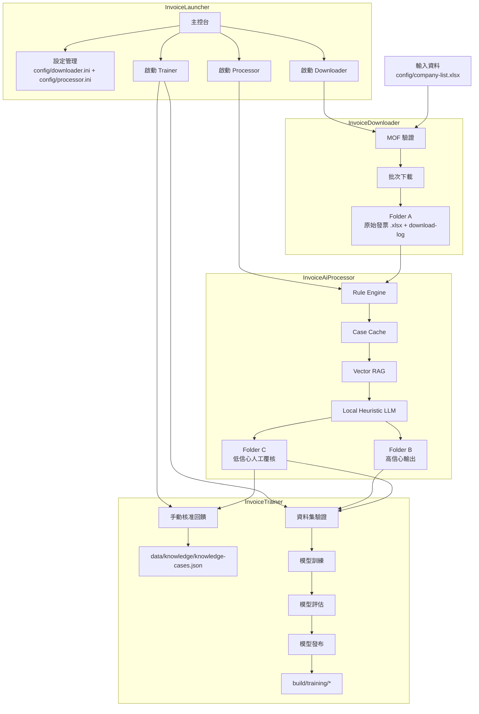

# 發票智慧助理

以 Windows 在地部署為優先的桌面解決方案，提供發票下載、AI 輔助會計判定、人工覆核分流，以及訓練/治理流程。

> 事實來源：以 `src/` 程式碼、`scripts/` 腳本、`config/` 設定範本為準。

## 專案概述

此解決方案包含 4 個 WPF 應用程式與 1 個共用核心函式庫：

- **InvoiceLauncher**：整合式主控台，集中設定與模組啟動協調。
- **InvoiceDownloader**：客戶清單匯入、MOF 驗證、批次下載發票至 Folder A。
- **InvoiceAiProcessor**：規則/快取/RAG/本地 LLM 判定管線，輸出到 Folder B / Folder C。
- **InvoiceTrainer**：人工回饋寫回知識庫 + 資料集驗證/訓練/評估/發布流程（UI 操作，無需 CLI）。
- **InvoiceIntelligence.Core**：共用設定、下載器、處理器、訓練器與治理邏輯。

## 儲存庫結構

```text
invoice-intelligence-assistant/
|- src/
|  |- InvoiceLauncher/
|  |- InvoiceDownloader/
|  |- InvoiceAiProcessor/
|  |- InvoiceTrainer/
|  |- InvoiceAppBootstrapper/
|  `- InvoiceIntelligence.Core/
|- tests/InvoiceIntelligence.Core.Tests/
|- scripts/
|- config/
`- docs/
```

## 執行架構

### 端到端流程

1. Downloader 從 `config/company-list.xlsx` 匯入客戶資料。
2. 使用者完成 MOF 認證。
3. Downloader 依客戶輸出 `.xlsx` 到 **Folder A**，並產生批次 `download-log-*.log`。
4. Processor 讀取 Folder A `.xlsx`，依序執行：
   - 規則引擎
   - 記憶體案例快取
   - 向量 RAG 檢索
   - 本地啟發式 LLM 補判
5. Processor 輸出：
   - **Folder B**（可直接使用）
   - **Folder C**（低信心/人工覆核）
6. Trainer 支援：
   - 將人工核准回饋寫入本地知識庫
   - 模型驗證/訓練/評估/發布

### 全模組流程圖



### 部署執行目錄

發佈腳本會產生啟動包裝程式，並將實際執行檔移入 `libs/`。

```text
InvoiceIntelligence/
|- InvoiceLauncher.exe
|- libs/
|- downloader/
|  |- InvoiceDownloader.exe
|  `- libs/
|- processor/
|  |- InvoiceAiProcessor.exe
|  `- libs/
|- trainer/
|  |- InvoiceTrainer.exe
|  `- libs/
`- config/
   |- downloader.ini
   `- processor.ini
```

`InvoiceAppBootstrapper` 會啟動對應 `libs\<AppName>.exe`。

## 環境需求

- **作業系統**：Windows（桌面目標為 `net8.0-windows`）。
- **.NET SDK**：
  - 建置與發佈需 SDK 8+。
  - 執行測試目前需 SDK 9+（測試專案目標 `net9.0-windows`）。
- PowerShell 5.1+。

## 開發快速開始

### 1) 環境自檢

```powershell
Set-ExecutionPolicy -Scope Process -ExecutionPolicy Bypass -Force
.\scripts\check-developer-environment.ps1
```

可選：

```powershell
.\scripts\check-developer-environment.ps1 -Configuration Debug
```

### 2) 還原 / 建置 / 測試

```powershell
dotnet restore .\InvoiceIntelligenceAssistant.slnx -v minimal
dotnet build .\InvoiceIntelligenceAssistant.slnx -c Release --no-restore -v minimal
dotnet test .\tests\InvoiceIntelligence.Core.Tests\InvoiceIntelligence.Core.Tests.csproj -c Release -v minimal
```

### 3) 由原始碼執行

```powershell
dotnet run --project .\src\InvoiceLauncher\InvoiceLauncher.csproj
dotnet run --project .\src\InvoiceDownloader\InvoiceDownloader.csproj
dotnet run --project .\src\InvoiceAiProcessor\InvoiceAiProcessor.csproj
dotnet run --project .\src\InvoiceTrainer\InvoiceTrainer.csproj
```

## 打包與部署

### 發佈腳本

```powershell
.\scripts\publish-downloader.ps1
.\scripts\publish-processor.ps1
.\scripts\publish-trainer.ps1
.\scripts\publish-all.ps1
```

常用參數：

- `-Configuration Release|Debug`
- `-Runtime win-x64|win-x86|win-arm64`
- `-SelfContained`（否則為 framework-dependent）
- `-SkipDeveloperEnvironmentCheck`
- `-OutputPath`（單模組）/ `-DeployRoot`（`publish-all.ps1`）
- `-SkipZip`（僅 `publish-all.ps1`）

### 客戶端環境檢查

```powershell
.\scripts\check-customer-environment.ps1 -Profile all -PublishMode framework-dependent -Runtime win-x64 -RequiredRuntimeVersion 8.0.0
```

回傳碼：

- `0`：可部署
- `1`：不可部署

## 設定檔說明

主要設定檔：

- `config/downloader.ini`
- `config/processor.ini`

### `downloader.ini`

| 區段 | 欄位 | 是否必填 | 預設值 | 說明 |
|---|---|---|---|---|
| `module` | `name` | 是 | — | 通常為 `InvoiceDownloader` |
| `paths` | `folderA` | 是 | — | 原始輸出資料夾 |
| `paths` | `folderB` | 是 | — | 保留/相容用途路徑 |
| `input` | `customerListFile` | 否 | `config\company-list.xlsx` | 客戶清單工作簿 |
| `output` | `fileNamingRule` | 是 | — | 至少需包含一個 placeholder |
| `output` | `invoiceFileSuffix` | 否 | `invoice` | 僅允許英數、`-`、`_` |
| `output` | `allowanceFileSuffix` | 否 | `allowance` | 僅允許英數、`-`、`_` |
| `mof` | `account` | 是 | — | MOF 帳號 |
| `mof` | `officialApiBaseUrl` | 否* | 官方 MOF URL | 當明確設定 `invoiceDownloadMode=official` 時必填 |
| `mof` | `appId` | 條件式 | 回退到 `appKey` | 若空值則使用 `appKey` |
| `mof` | `appKey` | 是 | — | 同時可作為 appId 回退值 |
| `mof` | `passwordEncrypted` | 否 | 空字串 | Windows DPAPI 加密密碼 |
| `mof` | `invoiceDownloadMode` | 否 | `official` | 目前僅支援 `official` |

### `processor.ini`

| 區段 | 欄位 | 是否必填 | 預設值 | 說明 |
|---|---|---|---|---|
| `module` | `name` | 是 | — | 通常為 `InvoiceAiProcessor` |
| `paths` | `folderA` | 是 | — | 輸入資料夾（僅讀 `.xlsx`） |
| `paths` | `folderB` | 是 | — | AI 輸出資料夾 |
| `paths` | `folderC` | 否 | `data\folder-c-review` | 人工覆核資料夾 |
| `output` | `fileNamingRule` | 是 | — | 使用命名 placeholder |
| `output` | `invoiceOutputLabel` | 否 | `SalesInvoiceDetail-T3` | 輸出檔名尾碼 |
| `output` | `allowanceOutputLabel` | 否 | `PurchaseVoucherDetail-T4` | 輸出檔名尾碼 |
| `output` | `invoiceFileSuffix` | 否 | `invoice` | 來源檔分類尾碼 |
| `output` | `allowanceFileSuffix` | 否 | `allowance` | 來源檔分類尾碼 |
| `review` | `confidenceThreshold` | 否 | `0.80` | 0 到 1 之間小數 |
| `knowledge` | `repositoryFile` | 否 | `data\knowledge\knowledge-cases.json` | 本地知識庫檔案 |

### 命名規則 Placeholder

允許的 placeholder：

- `{taxId}`
- `{companyName}`
- `{dateFrom}`
- `{dateTo}`
- `{timestamp}`

至少需包含一個 placeholder。

## 核心工作流程

### 下載流程

1. 匯入客戶清單（`.xlsx`）。
2. 驗證 MOF 工作階段。
3. 執行批次下載。
4. 在 Folder A 產生每客戶輸出檔與 `download-log-*.log`。

### 處理流程

1. 讀取 Folder A `.xlsx`。
2. 每筆資料依序經過 rule engine -> case cache -> vector RAG -> local heuristic LLM。
3. 依來源檔群組與信心門檻進行分流。
4. 高信心輸出到 Folder B，低信心群組輸出到 Folder C。

### 訓練流程

1. **手動知識回饋分頁**：勾選核准資料並寫回知識庫。
2. **訓練流程分頁**：
   - 選擇資料集 `.xlsx`
   - 驗證資料集
   - 訓練模型（`build/training/staged-model.json`）
   - 評估模型（`build/training/evaluation-report.json`）
   - 發布模型（`build/training/published-model.json` + `publish-metadata.json`）

資料集驗證需具備以下欄位（或其別名）：

- 公司名稱
- 發票日期
- 品名
- 可抵稅標籤
- 建議科目
- 判定原因

治理品質報告輸出位置：

- `build/training/quality-gates/validation-summary.json`
- `build/training/quality-gates/reject-report.json`
- `build/training/quality-gates/conflict-report.json`

## 公開 API 與擴充點

本儲存庫目前**不提供** HTTP/REST API。

主要擴充點為 `src/InvoiceIntelligence.Core` 的介面：

- `ICustomerListImporter`
- `IMofAuthenticator`
- `IMofOfficialInvoiceApiClient`
- `IBatchInvoiceDownloader`
- `IOfficialInvoiceExporter`
- `IRuleEngine`
- `ICaseCache`
- `IRagRetriever`
- `ILocalLlmAnalyzer`
- `IKnowledgeCaseRepository`
- `IModuleConfigurationLoader`

## 環境變數

應用模組執行不依賴自訂環境變數。

PowerShell 腳本僅讀取標準系統環境變數：

- `OS`
- `PROCESSOR_ARCHITECTURE`
- `COMPUTERNAME`

## CI 與容器化狀態

依目前儲存庫掃描結果：

- 未找到 Dockerfile。
- `.github/workflows` 下未找到 GitHub Actions 工作流程。

## 相關文件

- PRD 索引：`docs/prd/00-index.md`
- 主 PRD：`docs/prd/01-master-prd.md`
- 專案定義：`docs/project.md`
- 測試文件：`docs/testing.md`
- 治理政策設定：`docs/config/governance/`
- release gate 設定：`docs/config/release-gate/`
